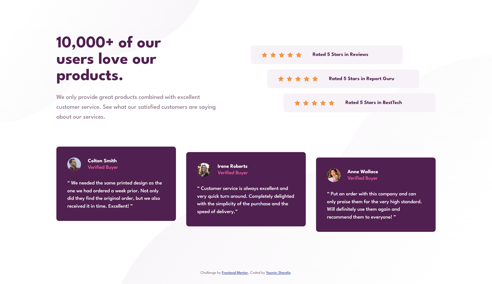
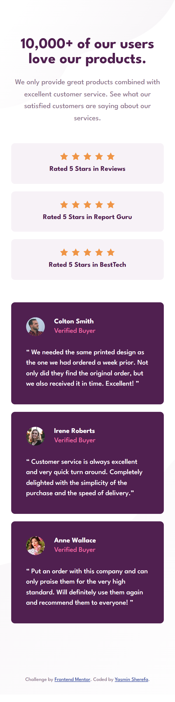

# Social proof section

My solution to the Social proof section challenge on [Frontend Mentor](https://www.frontendmentor.io/challenges).

## Screenshots

| Desktop | Mobile |
| --- | --- |
|  |  |

## Overview

The goal of this challenge was to build a social proof section that matches the design as closely as possible and adapts to different screen sizes. On mobile, everything stacks in one centered column. On desktop, the text and ratings sit side by side, and the three testimonial cards sit in a row.

## Links

- Live site: https://yasmin3802.github.io/social-proof-section/
- Repository: https://github.com/yasmin3802/social-proof-section

## Built with

- Semantic HTML5
- CSS custom properties
- Flexbox
- CSS Grid
- Mobile-first workflow
- League Spartan font from Google Fonts

## How I built it

I started with the HTML first, using semantic elements like `main`, `section`, `figure` and `blockquote` so the content makes sense without any styling. Then I wrote the CSS mobile-first, which means the base styles are for the small screen and one media query (`min-width: 62.5rem`) adds the desktop layout.

I stored the colors and base font size from the style guide in CSS variables so they are easy to find and change. I used Grid to place the intro text next to the ratings and to lay out the three cards in columns. I used Flexbox to align the stars, labels and avatars inside each box.

For the staggered look on desktop, I used `margin-left` on the rating boxes and `transform: translateY()` on the cards, targeted with `:nth-child`. The background patterns are set on the `body`, with separate images for mobile and desktop.

## What I learned

- How to plan a layout mobile-first and add a desktop breakpoint only when needed.
- When to use Grid (page-level layout) and when to use Flexbox (aligning items inside a component).
- How to recreate the offset effect from the design with `:nth-child` and `transform`.
- How to compare my work against the design images and fix small spacing and font-size differences.

## Continued development

Next time I want to practice using a CSS preprocessor like Sass, and test my layout on more screen sizes between mobile and desktop.

## Run it locally

Open `index.html` in your browser. No build step is needed.

## Author

Yasmin Sherefa
